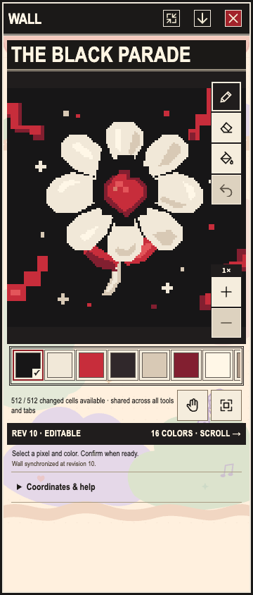
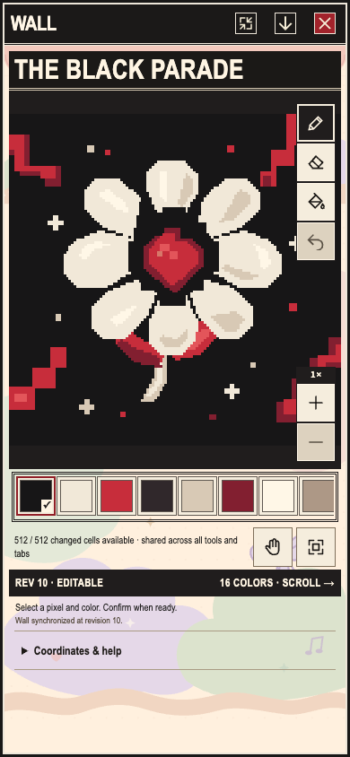
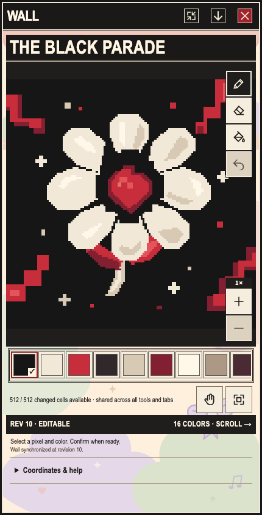
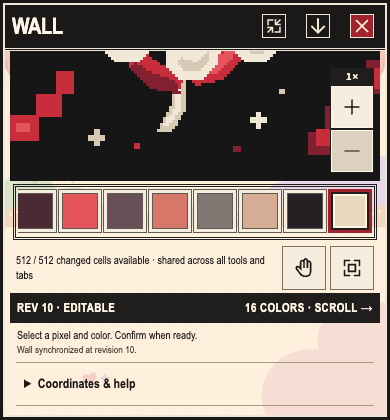

# QA06 approved Wall motif — actual-App fixture

**MOCK_READY**, round02 exit0, all3cases PASS. [Owner assessment](owner-assessment.json), [runtime report](round-02/report.json), [custody](custody-check.json), [release](release.json).

Actual-App Wall at360/390/430×844 renders the exact approved128×128/16-color motif. Every editor cell RGBA matches approved pack hash `4b3846029b0e9b0c5bdf2ca602efba2a4c2219f6bc20db5df548af3262074590`. Existing canonical UI-login/Auth/C05/placement fixture remains unchanged. Only the successful synthetic C04 GET snapshot's palette/pixels change to the exact approved pack, with metadata unchanged. This is not live backend provisioning or real snapshot acceptance.

I personally inspected all4 final images: legible cream-petal/red-center motif, proportional canvas and actual toolbar/palette/zoom/state labels. Bounds/no horizontal overflow pass. Five toolbar targets and first/last palette colors pass44px center-hit after real scrolling. At390×420 the scrolled panel shows lower canvas/palette/status/coordinates and reachable Fit; the entire motif is not simultaneously visible. This is not a real phone keyboard/safe-area test. Selected era is REVENGE from the unchanged fixture, superseding the earlier PARADE plan; THE BLACK PARADE is truthful independent event content.

|360×844|390×844|430×844|
|---|---|---|
||||

All3flows retain the same existing World canvas, socket peak1 and actual worldProof1mural/1game/1canvas; canonical UI logout disposes all sockets/blobURLs/Worldcanvas. No added nonGET domain request occurs after login. Editor pixel equality does not independently certify the world's mural texture. Home-key focus is diagnostic, not a navigation pass. No paint/fill/erase/undo/submit/save/upload, product/CSS/fixture/shared-contract/art writes.

Round01 retains3 runtime passes but native exit143 after an own shutdown hang; only owned Node was terminated. Round02 reuses pinned existing placement instead of unnecessary SSR recomputation and bounds Vite close5s; actual close resolved2ms, exit0/FULL within original finite clock. Eight PNG including failed carry remain charged/preserved. Successful raw report had a literal trailing backslash-n: report.raw.txt preserves exact bytes, report.json normalizes only suffix, final runner corrects only serialization. Both source hashes and reconstruction equality are recorded. No failed result is relabeled.

All444 source hashes/23publicasset pins/8PNG dimensions+hashes/70originalfiles pass custody checks. Planning check exits0/PASS, not application/live/device acceptance. Map stage publication aeb7512b (owner1d34b5af/native02fbbfe633) is reused; native01 rejected, all10ART06sourcepacks unchanged, two consumerpostimages intentionally changed. New densityc053 remains unqualified; no duplicate Map job.

Original goal1793759287 remains BLOCKED/unfinished. Physical Safari/Android Chrome, real keyboard/hardware safe area, other eras, fullten-screen reference/61IA and live authorization remain open. Direct normal publication goes to Root153 without king/SL/QA review or acknowledgment. No resource slot held.
