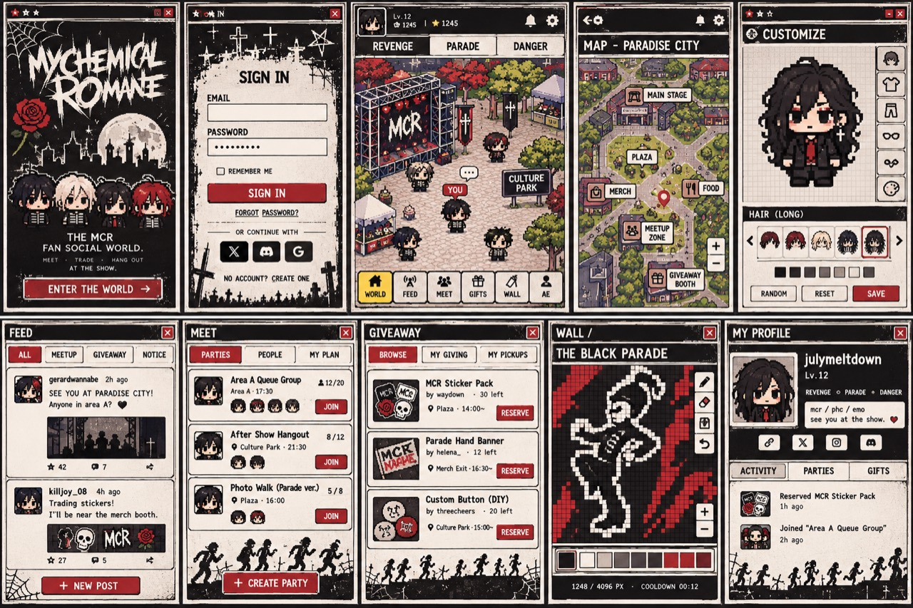
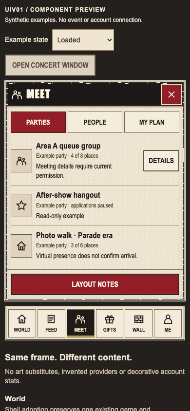
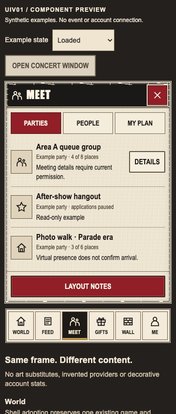
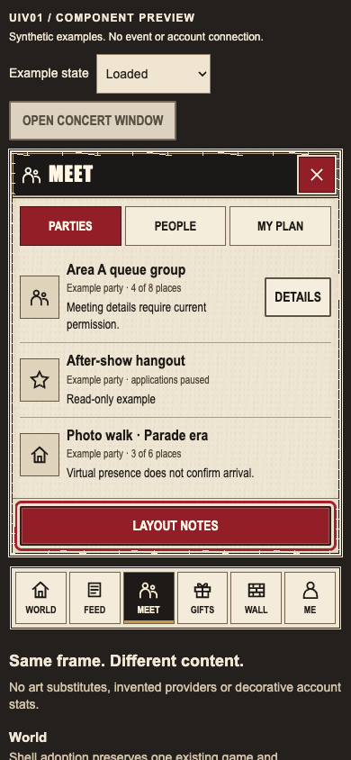
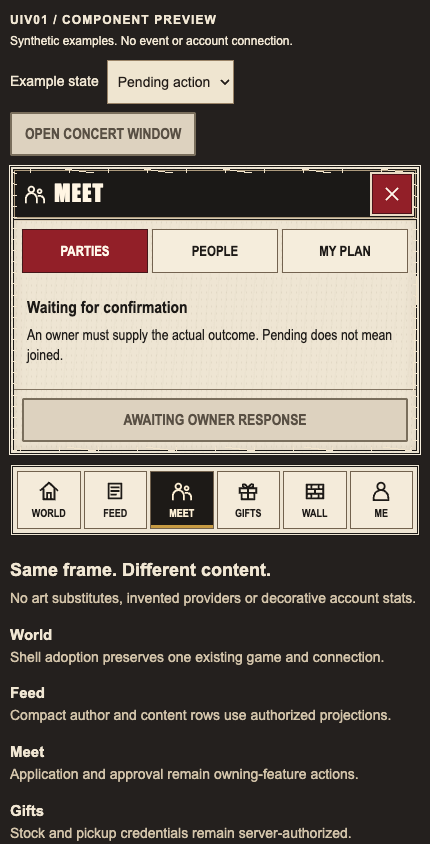

# UIV01 concert-window presentation

Status: **MOCK_READY**, 2026-11-04 (Asia/Seoul). The bounded shared presentation
set and deterministic browser examples are delivered. Application adoption,
real feature actions, physical devices and full visual acceptance remain separate.
The existing feature qualification and 112-task release denominator are unchanged.

## Ownership and reference

- Isolated worktree: `/Users/lhs/Desktop/mcr-worktrees/fe-concert-window`.
- Branch: `codex/mcr-fe-UIV01`.
- Exact base: `be85021c1e28f0b0f4a6182c4300a93b16179f5b`.
- Explicit new shared-path grant: `frontend/src/shared/ui/concert-window/**`
  and this document. No existing styles, shell/router, barrel, feature, contract,
  manifest/lockfile, backend or image was changed. Only main publishes.
- Read the [ten-screen audit](../design/ui-ux-reference-review.md) and visually
  inspected its unchanged [user reference](../design/ui-reference-audit-2026-11-04/user-reference.jpg).
  SHA-256: `2b3988d546f87b813d78ca13bf267730a6dd19118bd6535a2d3c3032b6f12d23`.
  This is distinct from the earlier five-world sheet. The implementation preserves
  black window chrome, ivory paper, deep-red controls, condensed uppercase display
  text, compact rows and icon-plus-label navigation from the current reference.
- Existing required specification/assessment/execution documents were read in the
  preceding assignment and verified unchanged at this base before implementation.

## Component contract

Import explicitly from `shared/ui/concert-window`; the root shared-UI barrel is
not edited. Its stylesheet is imported by the new module and scoped to
`.concert-kit` / `.concert-window`. The fixture has separate fixture-only CSS.

| Export | Contract / responsibility |
| --- | --- |
| `ConcertWindow` | Labeled in-flow section, black title bar, chosen heading level, optional decorative icon, accessible red close button, body and footer slots. It is not a modal. Its owner supplies close/navigation and focus restoration; no implicit Escape handling or focus trap. Omit `onClose` when dismissal is unavailable. |
| `ConcertAction` | Native button props/ref, red or paper tone, 44px minimum. `pending` disables the button and sets `aria-busy`; caller supplies truthful pending text and owns all outcomes. It performs no request or retry. |
| `ConcertTabs` | Styles the existing MCR `Tabs` component. Controlled value/items/callback, linked tab/panel IDs, automatic activation, Arrow/Home/End navigation and roving tab stops remain the existing implementation. Never use tabs to imply a completed mutation. |
| `ConcertNavigation` | Semantic navigation/list/links with decorative inline icons, visible labels and `aria-current="page"`. Caller supplies authorized destinations and current ID; the router owns navigation and identity. |
| `ConcertRow` | Semantic list item with optional approved/authorized visual, title, metadata, description and action slots. Place in `<ul className="concert-rows">`; absence of a visual does not fabricate an avatar. |
| `ConcertState` | Owner-supplied empty/unavailable/pending title and text in a polite status region. No inferred success. Use existing feature error semantics for urgent errors rather than making all messages alerts. |
| `ConcertIcon` | Newly authored decorative SVG glyphs: world, feed, meet, gifts, wall, me, close and star. They are hidden from assistive technology; containing controls supply names. They are interface symbols, not character art. |

```tsx
import { ConcertWindow, ConcertAction, ConcertRow } from './shared/ui/concert-window'

// The owning feature supplies current authorized data, callbacks and state.
<ConcertWindow title="Meet" icon="meet" onClose={closePanel}>
  <ul className="concert-rows">
    <ConcertRow title={party.title} metadata={party.currentSummary}
      action={<ConcertAction pending={pending} onClick={openPartyDetails}>
        {pending ? 'Waiting for confirmation' : 'Details'}
      </ConcertAction>} />
  </ul>
</ConcertWindow>
```

The frame uses a symmetric double border with restrained, original procedural
scuffs over the complete perimeter. Paper grain is CSS; no user artwork is edited
or traced. Focus outlines remain symmetric. No decorative left accent is present.
Typography uses existing system Impact/Arial Narrow/Helvetica/Arial fallbacks;
no remote font or dependency is introduced. Fallback font metrics may differ by OS.
The reference's tiny controls are deliberately enlarged to 44px minimum.
Navigation wraps for longer labels rather than clipping. Safe-area padding lives
in navigation and fixture edges; the application adopter still owns shell insets.
Reduced-motion preferences disable local motion. Private state, Auth, sockets,
Phaser, capacity and permission decisions are outside this presentation module.

## Local examples and browser evidence

The deterministic preview shows a compact Meet window with three synthetic rows,
local Details/layout-note disclosure, keyboard tabs, all six icon links, close and
reopen focus handling, and loaded/empty/unavailable/pending states. Its destination
links scroll to local explanatory sections. It has no backend or identity
connection and sends no mutation. It never simulates joining, reserving, posting
or successful completion. Pending text explicitly says it does not mean joined.
Unavailable/pending primary controls are disabled. Generic interface glyphs occupy
visual slots; no character substitute or unqualified media is presented.

The native Chrome runner builds the preview entry into an isolated temporary
directory and serves the build, then removes that directory. No browser download,
install or dependency prebundle/cache writes are needed. Use Node 24.22.2 and the
retained dependencies through the explicitly authorized temporary local symlink.

```sh
# From frontend/, with retained dependencies available:
/Users/lhs/Desktop/mcr-tools/node-v24.22.2-darwin-arm64/bin/node src/shared/ui/concert-window/__tests__/browser.mjs
```

Optional `MCR_CHROME_EXECUTABLE` selects an existing Chrome executable; the default
is `/Applications/Google Chrome.app/Contents/MacOS/Google Chrome`. No environment
or production config is changed. The committed [report](../../../frontend/src/shared/ui/concert-window/__tests__/evidence/report.json)
records base, actual checkout HEAD before commit, tested source hashes, unchanged
reference hash, Chrome `156.0.8078.80`, Node version, three results and the SHA-256
of every retained screenshot. The source hashes bind the tested dirty source to
the final commit; no claim that the base alone contains this implementation.

Each width has loaded, empty, unavailable, pending and keyboard-focus captures:
15 durable screenshots at 360/390/430 × 844 CSS pixels, touch enabled and reduced
motion. Browser assertions verify Arrow/Home/End/Tab navigation, selected panel,
visible focus and local primary action via Enter, close/reopen and returned focus,
real local navigation anchors, 44px targets, prompt first-row visibility, truthful
states, zero horizontal overflow, runtime exceptions and external requests.
Loaded 360/390, keyboard 390 and pending 430 images were visually inspected. The
final 390 loaded capture was inspected again after the perimeter-scuff change.

| Unchanged ten-screen reference | UIV01 local specimen |
| --- | --- |
|  |  |

| 360px | 390px keyboard focus | 430px pending |
| --- | --- | --- |
|  |  |  |

Remaining visual differences: no character portraits, venue illustration, poster
lettering, decorative silhouettes or content photography are supplied by this
component package. The grain/scuffs are restrained procedural treatment rather
than a copy of the collage. Font metrics follow local installed system fonts.
Fixture controls and explanatory notes are evidence tooling and must not be
copied into the application. The actual shell/screens still need separately
owned adoption and comparable captures with approved assets and real state.

## Validation and provenance

`NODE` below is the exact pinned executable
`/Users/lhs/Desktop/mcr-tools/node-v24.22.2-darwin-arm64/bin/node`.
Commands ran at worktree root unless noted. The temporary dependency symlink is
removed before the final boundary check. No shared incremental cache is written.

| Command | Exit / result |
| --- | --- |
| `NODE frontend/node_modules/typescript/bin/tsc --project frontend/tsconfig.json --pretty false --incremental false` | 0; strict whole-frontend types |
| `NODE frontend/node_modules/oxlint/bin/oxlint frontend/src/shared/ui/concert-window` | 0; no warnings/errors |
| `NODE frontend/node_modules/vitest/vitest.mjs run --root frontend --maxWorkers=1 --no-cache --configLoader runner src/shared/ui/__tests__/primitives.test.tsx` | 0; 11 existing MCR primitive regressions, including reused tabs |
| From `frontend/`: `NODE src/shared/ui/concert-window/__tests__/browser.mjs` | 0; actual standalone production build of new components and preview, 18 modules; three widths and 15 screenshots; final rerun after CSS scuffs passes |
| `python3 scripts/mcr/check-plan.py` | 0; planning/source provenance only; 13 source archive hashes and required scope intact |
| `python3 scripts/mcr/check-boundaries.py --base be85021c1e28f0b0f4a6182c4300a93b16179f5b --lane frontend --allow-doc docs/mcr/frontend/concert-window.md` | 0; exact new-path ownership additionally checked |
| `git diff --cached --check` | 0; explicit paths staged and checked |

All new rendering/styles/icons/preview/test orchestration are authored for UIV01.
The only existing UI import is newly authored MCR `shared/ui/Tabs.tsx`, unchanged,
last source commit `ae24437645454467a38f810c196a049c21508b51`, SHA-256
`4ee35f9bb32595681107138943b38b5c8fcaee9532cd052985482d19ae5fe1ee`.
Its already qualified functional behavior is reused, with the targeted primitive
and native browser checks above. No Bigyeting rendering, copied user artwork,
new visual library, generated character or legacy fallback is introduced.
Dependencies are existing React/React DOM and existing development tools only;
HTTP/realtime/asset contracts and all retained lockfile resolutions are unchanged.

The final explicit-path commit is a direct child of the exact assignment base and
is identified by SHA in the READY handoff; its source hashes match the retained
report. No second SL approval is required. Main publishes without force-push.
Production adoption, route behavior, live feature outcomes, devices/screen readers,
integrated contrast/asset review, performance and project release remain **NOT_RUN**.
