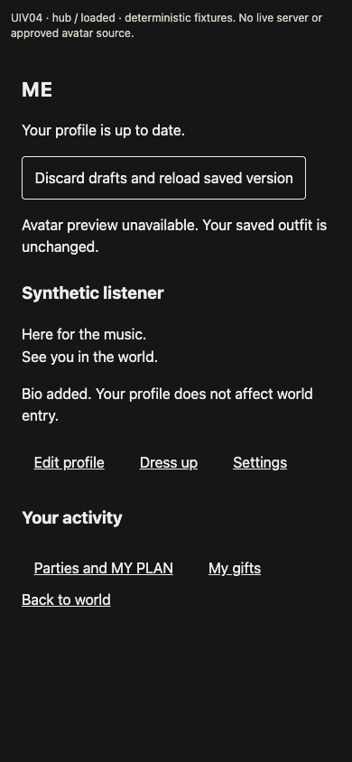
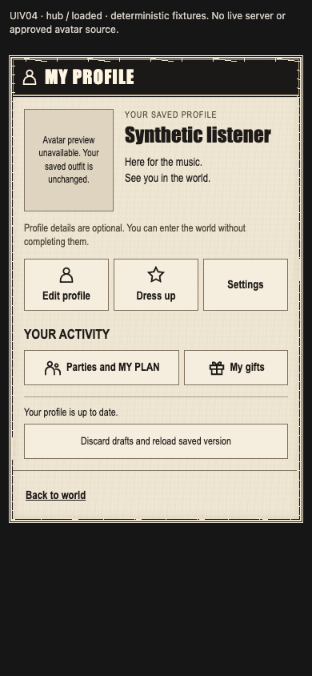
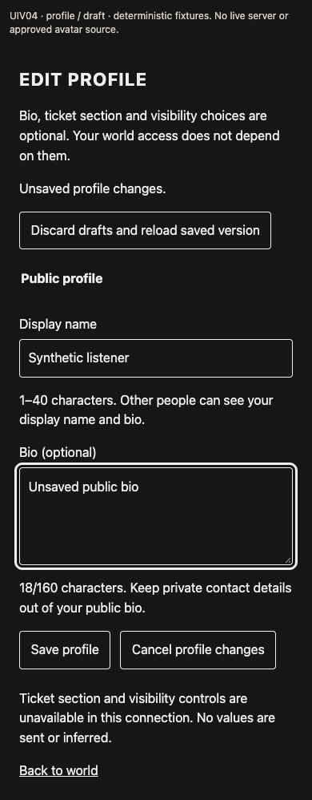
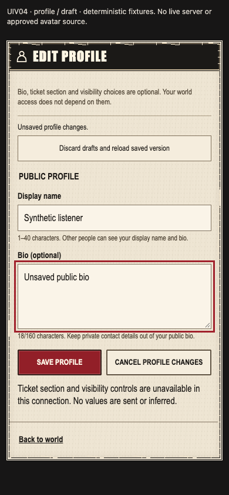

# UIV04-ME — profile concert-window adoption

Status: **MOCK_READY / scoped UI READY**. Actual `MeHub` and owner `ProfileForm` render the shared concert window. This is a committed integration handoff, not live-profile, art, device, screen-reader, multiuser, shell-wide or release acceptance.

## Source and ownership

- Exact parent/base: `11d7cb00165f78b2ec9c564dd93669edad104e88` on `codex/mcr-fe-UIV04-me` in `/Users/lhs/Desktop/mcr-worktrees/fe-me-visual`.
- Production changes: `frontend/src/features/me/ui/MePages.tsx` and `frontend/src/features/me/ui/me.css` only. New tests and evidence are under `frontend/src/features/me/__tests__/visual-adoption/`; this document is the only documentation change.
- User reference viewed: `docs/mcr/design/ui-reference-audit-2026-11-04/user-reference.jpg`, SHA-256 `2b3988d546f87b813d78ca13bf267730a6dd19118bd6535a2d3c3032b6f12d23`. The bottom-right profile composition informs the compact black titlebar, ivory frame, strong saved identity and dense destination links.
- Newly authored React/CSS; no copied legacy rendering or added dependencies. Existing concert-window components are reused. No character image was introduced. Supplied originals, source pack, `AvatarThumbnail`, controllers, contracts, privacy/auth, Settings, root composition, manifests and lockfiles are unchanged.
- The author commit containing this document is the handoff commit; its parent must equal the base above. The main delivery chat publishes the reviewed exact SHA; this writer does not push.

## Result and preserved behavior

The hub leads with the saved display name, bio and existing reviewed-thumbnail seam. Its three profile destinations and two activity destinations retain their exact router IDs/URLs: `/me/profile`, `/me/avatar`, `/me/settings`, `/meet`, `/gifts/mine`. The footer retains `/world`. There are no invented activity items, counts, levels, social links, tab panels or avatar fallback artwork. Without a reviewed source, the existing thumbnail accurately explains that the preview is unavailable and the saved outfit is unchanged. Loading/error/expired states use the canonical controller messages.

The form retains public-field hints, optionality, privacy guidance, the owner `optionalFields.render({ controller })` port and the exact field changes/save/cancel calls. No request shape or revision behavior changes. Save remains gated by participant, dirty state, blocked state and the disabled fieldset. Shared actions additionally expose pending state through `aria-busy` and explicit disabled attributes. Conflict drafts stay visible with a disabled save and the existing explicit reload action; expiry clears fields through the original controller.

Only the two assigned components opt in with `me-view--concert`. The original CSS prefix is preserved byte for byte and the appended overrides require that modifier. `MeStatus` remains unchanged for its Settings consumer. Settings DOM geometry and computed color/background/font/border signatures match before/after at 360/390/430px. The existing small Settings back link is outside this assignment and remains unchanged.

## Evidence and checks

Run from the isolated `frontend/`, using `/Users/lhs/Desktop/mcr-tools/node-v24.22.2-darwin-arm64/bin/node` (abbreviated `node` below), retained dependencies and local Chrome. The removable dependency symlink is not committed. Vite fixture caches and build output use `/tmp`; no lockfile regeneration.

| Check | Command | Result |
| --- | --- | --- |
| Baseline browser | `UIV04_PHASE=before node src/features/me/__tests__/visual-adoption/browser.mjs` | Exit 0; 9 screenshots, original source hashes |
| Final browser | `node src/features/me/__tests__/visual-adoption/browser.mjs` | Exit 0; 51 route/state/width cases, plus 6 short-height captures |
| Existing Me / Settings / shared concert tests and added regressions | `node node_modules/vitest/vitest.mjs run --configLoader runner --no-cache src/features/me src/features/settings src/shared/ui/concert-window` | Exit 0; 132 tests / 11 files |
| Combined strict frontend types | `node node_modules/typescript/bin/tsc --noEmit --incremental false --pretty false` | Exit 0 |
| Combined lint | `node node_modules/oxlint/bin/oxlint src vite.config.ts` | Exit 0 |
| Planning provenance | `python3 scripts/mcr/check-plan.py` | Exit 0; planning check only |
| Production build | `node node_modules/vite/bin/vite.js build --configLoader runner --outDir /tmp/mcr-uiv04-build` | Exit 0; existing large-chunk warning |
| Expanded full frontend suite | `node node_modules/vitest/vitest.mjs run --configLoader runner --no-cache` | Exit 1; 2,204 passed, 5 failed, 14 skipped / 96 files |

Browser fixtures use the real components, controllers, privacy invalidation and actual MemoryRouter paths `/me`, `/me/profile`, `/me/settings`; transport and participant data are deterministic test fixtures. Hub cases: loaded, empty bio, unavailable (idle/no participant), load error, pending read, expired, maximum unbroken name/bio. Profile cases: loaded, empty bio, unavailable, load error, pending read, draft, conflict, pending save and expired. All run at 360/390/430 × 844 with reduced motion. Checks cover no horizontal overflow, assigned Me controls at least 44×44px, preserved link URLs, no substitute avatar imagery, cancel restoration, blocked conflict saves, disabled pending fields, keyboard focus outlines and scroll reachability at height 420. These checks are not a manual assistive-technology audit.

The full suite is **not green**. Two UUID/provenance tests require missing Python `date-time` and `uri` format checkers, also failing on the untouched base. The direct-beacon back-navigation failure reproduced on that base and passed in the changed-tree four-file rerun. Transport epoch-recovery and room-switch timing failures from the full run passed in that rerun; they are not claimed fixed. The same four files yielded 288 passed / 3 failed on base and 289 passed / 2 failed on this tree. See [validation record](../../../frontend/src/features/me/__tests__/visual-adoption/evidence/validation.json). No unrelated files were changed to address those failures.

The [before manifest](../../../frontend/src/features/me/__tests__/visual-adoption/evidence/before/result.json) and [after manifest](../../../frontend/src/features/me/__tests__/visual-adoption/evidence/after/result.json) bind screenshots to production/reference SHA-256 hashes; the final manifest also hashes fixture sources. The baseline fixture's PATCH transport discriminator was corrected during development before final conflict/saving evidence; baseline loaded/draft/Settings captures use GET and are unaffected.

The [PNG hash index](../../../frontend/src/features/me/__tests__/visual-adoption/evidence/screenshots-sha256.json) includes all 66 baseline/final/short-height captures. The [changed-path list](../../../frontend/src/features/me/__tests__/visual-adoption/evidence/changed-paths.txt) enumerates the exact handoff scope.

Viewed before/after representative captures directly, including loaded hub/form, error hub, conflict, pending save, maximum content and short-height scroll position. Visual inspection found the intended hierarchy, readable state messages, intact focus ring and no clipping. All evidence remains explicitly labeled as fixtures without a live server or approved avatar source.

| Before, 390px | After, 390px |
| --- | --- |
|  |  |
|  |  |

## Remaining acceptance

Live authenticated route composition, approved source-pack avatar rendering, physical devices, screen readers, cross-shell navigation, backend qualification and release acceptance remain separate. The shared primitive handles an in-flow region; no modal focus trap, fabricated close action or new shell/runtime is introduced. The persistent assignment goal can complete after this scoped committed handoff and review fixes; the unrelated broader failures remain disclosed for their owners.
