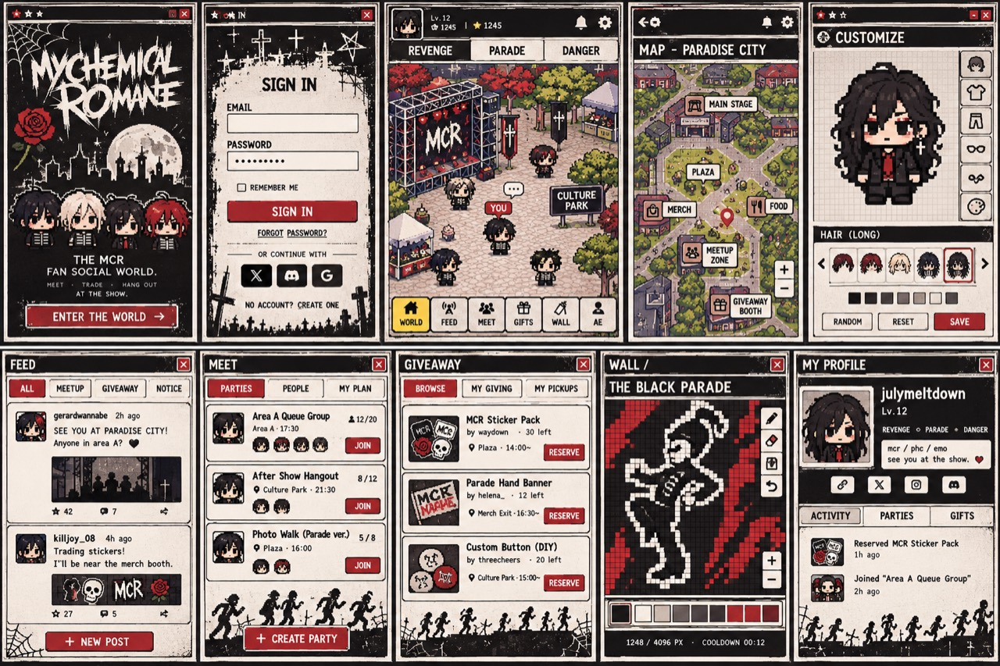
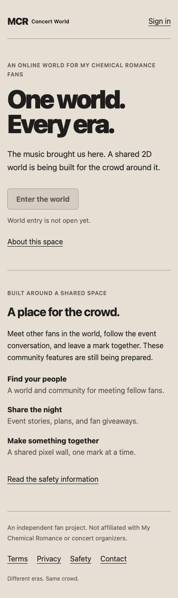
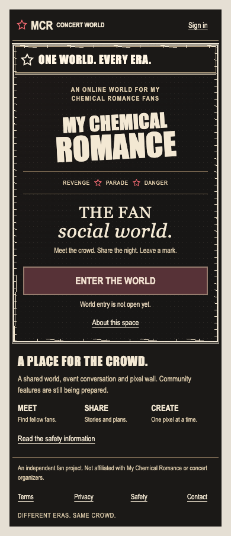
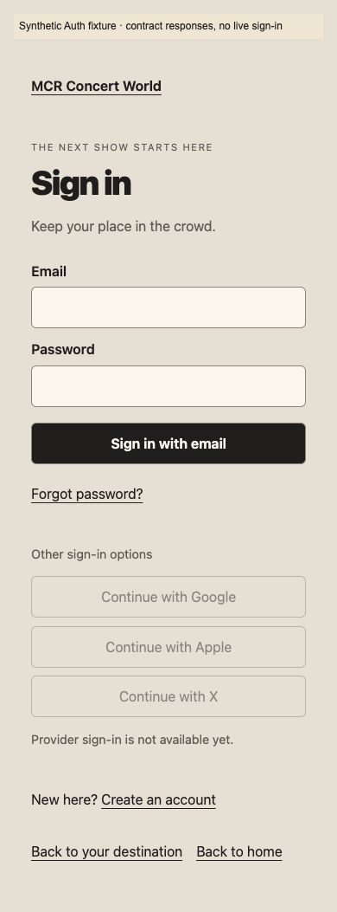
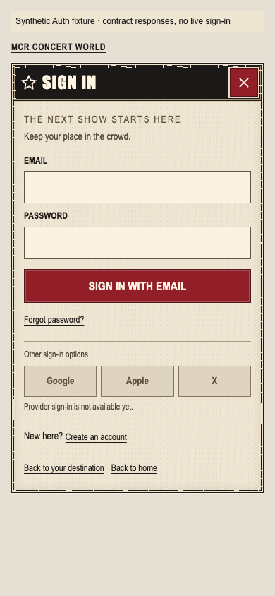
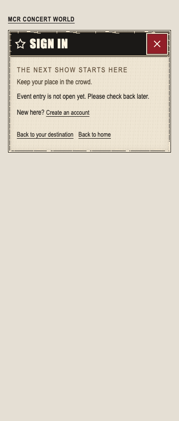

# UIV02 public entry and sign-in visual adoption

2026-11-04, Asia/Seoul. Status: **MOCK_READY** visual qualification. The actual
existing `/` and `/login` route components now adopt the concert-window direction;
these are application changes, not a second isolated component specimen. Live
entry/Auth readiness is unchanged. Shell/world adoption, approved character art,
physical devices and full visual/release acceptance remain separate.

## Ownership and delivered ancestry

- Worktree: `/Users/lhs/Desktop/mcr-worktrees/fe-public-auth-visual`.
- Branch: `codex/mcr-fe-UIV02-public-auth`.
- Exact assignment base: `453312121ae7539c027b9deb19009f9f569d4040`, containing
  published UIV01. This patch is a direct child; the READY handoff supplies its SHA.
- Production scope is exactly `public/ui/Landing.tsx`, `PublicFrame.tsx`,
  `public.css`, `auth/ui/SignIn.tsx` and `sign-in.css` under `frontend/src/features/`.
- New tests/evidence stay in `public/__tests__/visual-adoption/**` and
  `auth/__tests__/visual-adoption/**`; this is the sole new documentation path.
- No router, FoundationApp, controller/session/cookie policy, capability logic,
  contract, global base CSS, shared UIV01, manifest/lock, source image, backend,
  other auth page or old checkout changed. Main publishes; no worker push.
- Persistent goal was verified ACTIVE through implementation, validation, fixes
  and committed handoff. No second SL review or acknowledgement gate is required.

## Design and preserved behavior

The [ten-screen audit](../design/ui-ux-reference-review.md), specification,
assessment and execution plan were read. The actual unchanged reference was
viewed alongside before/after production and populated-fixture captures. It is
the ten-screen handoff, distinct from the historical five-world sheet. Reference
SHA-256: `2b3988d546f87b813d78ca13bf267730a6dd19118bd6535a2d3c3032b6f12d23`.

Landing now uses a black concert poster, distinctive condensed typographic
wordmark, original star glyphs, a symmetric distressed window, concise feature
summary and a prominent entry control. Sign-in uses an ivory paper surface,
black title bar, accessible red close control, compact labels/fields and deep-red
submit action. The three already-frozen provider buttons are arranged compactly
and retain their full accessible names. They remain disabled, including when a
fixture advertises providers. No Discord or unsupported provider is added.

The landing readiness status and redirect checks remain exact. Anonymous users
still receive `/login?returnTo=%2Fworld`; unqualified entry is disabled and explains
its state. No rendering change grants event entry. The sign-in orchestration
before its JSX return is byte-identical, retaining canonical subscription/privacy
cleanup, immediate password clearing, pending/duplicate protection, validation,
cookie transport, safe return target and unmount/navigation fences. The new title
bar close control navigates home; existing home/destination, create-account and
password-recovery links remain. No remember-me checkbox or fake provider action
was copied from the illustration. Pending never appears as success.

`PublicFrame` accepts an optional landing-only `appearance="poster"`. The default
document frame remains paper with its existing headings, metadata, loading,
unavailable/error handling, focus and links. Original public/sign-in CSS rules
remain an exact unchanged prefix; overrides are appended under
`.public-entry--poster` and `.auth-sign-in--concert`. Other auth pages do not use
the latter class. UIV01 imports are explicit; no shared barrel/global token edit.
Only existing MCR components are reused. No legacy rendering is introduced.

All controls retain 44px targets (fields/primary actions are at least 46/48px),
readable enabled-text contrast and visible symmetric keyboard outlines. Existing
body safe-area padding is retained; sign-in/footer bottom padding uses safe-area
insets. Reduced motion remains supported. No left rail or accent line is added.
The collage is not a runtime background; no user image is edited, traced or
replaced. No character substitute, level, balance, unverified venue claim or new
asset/font dependency appears. Lettering uses installed system fonts; metrics
may vary across OSes.

## Before and after

Baseline captures were made from the unchanged five production files at the
assignment base, before editing. Their hashes and source pins are in
[before.json](../../../frontend/src/features/public/__tests__/visual-adoption/evidence/before.json).
The baseline helper refuses to overwrite historical captures after those files
change.

| Unchanged user reference | Actual production landing, before | Actual production landing, after |
| --- | --- | --- |
|  |  |  |

| Sign-in before, labeled fixture | Sign-in after, same populated state | Actual production sign-in without event configuration |
| --- | --- | --- |
|  |  |  |

Remaining visual differences: approved character portraits, proprietary poster
lettering, illustrated silhouettes and collage ornament are absent. The poster
uses original typography and restrained CSS grain/scuffs. Disabled entry and
provider controls intentionally display their real availability. Full comparison
of a live signed-in destination awaits the separately owned integration gates.

## Browser evidence and limits

The [report](../../../frontend/src/features/public/__tests__/visual-adoption/evidence/report.json)
binds ten tested source files, reference hash, assignment base, precommit checkout
HEAD, Node version, Chrome `156.0.8078.80`, each screenshot hash and three viewport
results. The hashes bind tested working source to the final commit; the report
does not imply that the assignment base alone contains this patch.

The runner builds and serves two separate outputs: the actual production
`index.html`, and clearly labeled test HTML entries importing the same actual
router/components. Root captures have no configured event and no API fixture.
The populated Auth fixture uses the canonical real SessionController with mocked
contract responses at the browser transport boundary; document fixtures use the
existing synthetic provider data. Neither is live authentication or approved
policy. Fixture labels/errors/data are checked absent from production JS.

There are **51 final screenshots plus 9 baseline captures**, at 360/390/430 × 844
CSS pixels. Final captures cover actual home/login and unavailable documents,
signup/reset regressions, anonymous/checking/error entry, document loading/
published/error, and sign-in populated/keyboard/pending/credential-error/
capability-loading/capability-error. The final loaded 390 landing and sign-in,
actual unavailable 360 sign-in and 430 credential failure were visually inspected;
baseline 390 landing/sign-in were inspected before implementation. Inspection
caught title-bar spacing and an incidental focus outline in a normal capture;
the final corrected capture pass is retained.

Assertions cover keyboard skip/Tab/focus/Enter, duplicate suppression and immediate
password clearing, original provider gating, neutral error text, capability retry,
document focus and all four information routes, account/recovery navigation,
browser back including the new close action, 44px targets, no horizontal overflow,
and enabled text contrast on the solid underlying colors. Paper grain was also
visually inspected. Disabled controls are excluded from contrast assertions.
Reduced-height 420px reachability checks cover entry, password and submit controls;
these are soft-keyboard layout approximations, not physical keyboard/device tests.
Public pages allocate no game, Phaser asset or socket and make no external request.
Only synthetic failed login requests are exercised in this visual runner; native
cookies, successful safe-target behavior and privacy boundaries retain the existing
functional test coverage below. Real providers/devices/screen readers and hardware
safe-area behavior remain **NOT_RUN**.

## Commands and results

`NODE` means `/Users/lhs/Desktop/mcr-tools/node-v24.22.2-darwin-arm64/bin/node`.
No install or dependency/lockfile update was run. The authorized temporary
`frontend/node_modules` symlink read the qualified retained installation and was
removed before boundary checking. TypeScript disabled incremental output; the
browser build uses no config bundle/prebundle cache, and the standard production
build uses `--configLoader runner`.

| Command / check | Exit / result |
| --- | --- |
| `NODE frontend/node_modules/typescript/bin/tsc --project frontend/tsconfig.json --pretty false --incremental false` | 0; whole frontend strict types |
| `NODE frontend/node_modules/oxlint/bin/oxlint frontend/src/features/public frontend/src/features/auth` | 0; affected source and runners |
| Vitest command below | 0; 356 tests / 13 files, 9.01 seconds |
| From `frontend/`: `NODE src/features/public/__tests__/visual-adoption/browser.mjs` | 0; final 51 captures and all three viewport results PASS, actual production and fixture builds |
| From `frontend/`: `NODE node_modules/vite/bin/vite.js build --configLoader runner` | 0; standard production build, 319 modules; existing >500kB chunk warning remains (CommunityFeatures 809.36kB, Phaser 1198.04kB) |
| `python3 scripts/mcr/check-plan.py` | 0; planning/source archive provenance only, no scope/acceptance update |
| Boundary command below | 0; exact path list additionally inspected |
| `git diff --cached --check` and final source/evidence hash validation | 0; no whitespace or ownership drift |

```sh
NODE frontend/node_modules/vitest/vitest.mjs run --root frontend --maxWorkers=2 --no-cache --configLoader runner src/features/public/__tests__/documents.test.ts src/features/auth/__tests__ src/app/__tests__/public-entry.test.tsx src/app/__tests__/enrollment.test.tsx src/app/__tests__/recovery.test.tsx

python3 scripts/mcr/check-boundaries.py --base 453312121ae7539c027b9deb19009f9f569d4040 --lane frontend --allow-doc docs/mcr/frontend/public-auth-visual.md
```

Build/browser logs are retained beside the public visual report. Existing tests
exercise password byte validation, cookie policy, safe redirects, session/privacy
cleanup, unmounted completion, unavailable providers, document decoder/navigation,
signup and recovery. No controller behavior was reimplemented for appearance.
The five production file hashes, reused fixture imports and shared UIV01 remain
traceable to the recorded base and report. The source archive, canonical contracts,
auth controllers and all excluded application paths remain unchanged. Whole task,
live-service, approved-art and release acceptance are not inferred from this patch.
