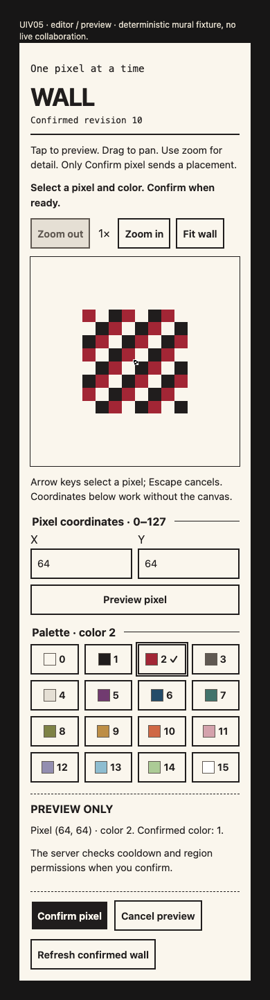
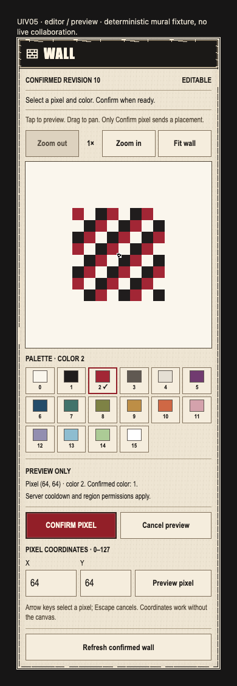
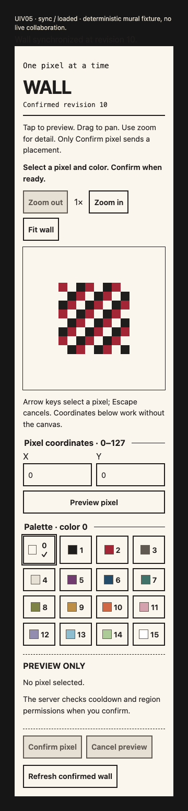
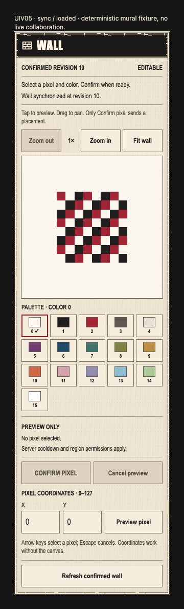

# UIV05-WALL — editor and synchronization presentation

Status: **MOCK_READY / scoped UI READY**. The actual `MuralEditor` and `MuralSyncPanel` now use the shared concert-window presentation. This committed handoff does not establish production `/wall` composition, live collaboration, native-device or IN04 acceptance.

## Ownership and source

- Exact base/parent: `3e3b54a3aa6052536cc48b5afadc0992e7482084`; branch `codex/mcr-fe-UIV05-wall`; isolated worktree `/Users/lhs/Desktop/mcr-worktrees/fe-wall-visual`. Previous Me checkout remains stopped.
- Production paths: `frontend/src/features/mural/editor/MuralEditor.tsx`, `frontend/src/features/mural/editor/editor.css`, `frontend/src/features/mural/sync/MuralSyncPanel.tsx` only.
- New fixture/tests/evidence: `visual-adoption/**` under editor and sync `__tests__`; this is the sole new documentation file. The author commit containing this record is the handoff SHA, with the exact base above as parent. Only the main delivery chat publishes master.
- Read the implementation specification, project assessment, execution plan, mural editor/sync records and UI reference audit. Viewed unchanged `docs/mcr/design/ui-reference-audit-2026-11-04/user-reference.jpg`, SHA-256 `2b3988d546f87b813d78ca13bf267730a6dd19118bd6535a2d3c3032b6f12d23`, and fresh before captures before editing production code.
- Newly authored JSX/CSS reuses `ConcertWindow`/`ConcertAction`. No copied legacy UI, added dependency, fake artwork or source-pack derivative. Controllers, input/contract/projection/HTTP/owner logic, admin/archive/root/shared UI/global CSS, manifests, lockfiles, backend and source art remain unchanged.
- Contracts remain the pinned C04 mural schema and existing public TypeScript ports at the base; source SHA-256 hashes in both browser reports bind those inputs. No contract or behavior amendment is implied by the reference.

## Presentation and preserved safety

The black titlebar and symmetric ivory frame contain current confirmed revision, qualified availability/cooldown, canonical command/sync messages, compact zoom controls and the confirmed canvas. The unchanged 16-color palette follows the canvas, with visible indexes/checkmark and the original hex-based accessible names/pressed states. Palette columns adapt to the available width while preserving 44px targets. The preview summary and red **Confirm pixel** action are followed by always-visible coordinate inputs, keyboard instructions and recovery controls. No tiny icon-only control or collapsed accessibility alternative was substituted for these existing actions.

All pointer/canvas math, keyboard handlers, raster construction, controller calls and field validation remain unchanged. Reordering the existing coordinate block does not change its submit behavior. Tap, arrow keys and coordinates only preview; only explicit Confirm dispatches a placement. Confirm continues to use `canConfirm()` and now exposes sending through the shared action's `aria-busy`. Server permission/cooldown checks, immutable confirmed state, region-lock rejection, pause/freeze, gap/error/read-only gating, pending/unknown outcomes and original-key status checks remain owned by the same controllers. Refresh/check never gains replay capability.

`MuralSyncPanel` supplies its unchanged labeled messages through a presentation-only `synchronizationStatus` React-node prop. They render near command status inside the window, including the full unresolved-placement/no-replay warning. Metadata prioritizes unresolved-command or non-writable availability over an otherwise EDITABLE snapshot, so a blocked client is not labeled editable. No synchronization logic or message outcome is inferred from styling.

The reference's drawn mural, title, draw/erase/undo tools and counters were not copied or invented. Existing geometric fixture pixels remain labeled deterministic test data. Product rendering uses only the actual supplied snapshot and palette. All decoration is symmetric; no decorative left rail/border is introduced.

## Validation

Commands run in isolated `frontend/` unless stated otherwise, with `/Users/lhs/Desktop/mcr-tools/node-v24.22.2-darwin-arm64/bin/node` (`node` below), retained dependencies through a removable untracked symlink, and installed local Chrome. No package/global install or dependency regeneration. Fixture Vite caches and build output use `/tmp`.

| Check | Command | Exit / result |
| --- | --- | --- |
| Baseline browser | `UIV05_PHASE=before node src/features/mural/editor/__tests__/visual-adoption/browser.mjs` | 0; 9 comparable captures |
| Final browser | `node src/features/mural/editor/__tests__/visual-adoption/browser.mjs` | 0; 84 route-state-width cases, 3 interaction flows, plus 12 height-420 captures |
| Affected existing and new tests | `node node_modules/vitest/vitest.mjs run --configLoader runner --no-cache src/features/mural src/world/mural src/app/__tests__/routes.test.ts src/app/__tests__/shell.test.tsx src/app/__tests__/community.test.tsx --reporter=json --outputFile=src/features/mural/editor/__tests__/visual-adoption/evidence/affected-tests.json` | 0; 205 tests / 12 files |
| Combined strict types | `node node_modules/typescript/bin/tsc --noEmit --incremental false --pretty false` | 0 |
| Combined lint | `node node_modules/oxlint/bin/oxlint src vite.config.ts` | 0 |
| Production build | `node node_modules/vite/bin/vite.js build --configLoader runner --outDir /tmp/mcr-uiv05-final-build` | 0; existing large-chunk warning |
| Planning provenance | From repository root: `python3 scripts/mcr/check-plan.py` | 0; planning evidence only |
| Broad frontend suite | Not repeated, per assignment | NOT_RUN |

At 360/390/430 × 844, with touch/mobile/reduced-motion emulation, the actual editor and sync wrapper render loaded, empty confirmed pixels, failed read, region-locked rejection, frozen, cooldown, pending, unknown, preview, loading, read-only, sending and paused cases. Sync also covers gap and unavailable authority. These are real controllers with existing deterministic fixture ports, not mocked React components or a live producer. The fixture clocks hold cooldown/gap states stable for inspection; existing controller tests cover time progression and bounded recovery.

Browser assertions verify all 16 palette controls, coordinate availability, correct confirm gating, region-lock/gap messages, no horizontal overflow, every editor button/input at least 44×44, keyboard focus outline and refresh reachability after scrolling a 420px-high viewport. Interaction flows verify arrow/Enter on canvas sends nothing, Escape cancels, zoom/fit, coordinate `(127,127)` preview without mutating the confirmed pixel, explicit keyboard confirm causing exactly one qualified revision/pixel update and cooldown block, then sync refresh/original-status lookup retaining the original key without another placement. New component regressions cover pending `aria-busy`/duplicate-submit prevention and gap/unresolved warnings inside the named wall region. Existing tests retain projection, HTTP, privacy, command, input and world-sink coverage.

The [baseline report](../../../frontend/src/features/mural/editor/__tests__/visual-adoption/evidence/before/report.json), [final report](../../../frontend/src/features/mural/editor/__tests__/visual-adoption/evidence/after/report.json) and [affected-test record](../../../frontend/src/features/mural/editor/__tests__/visual-adoption/evidence/affected-tests.json) record the actual sources/results. The final browser report hashes the three production files, shared styles/window, controller/input/contracts, fixture sources, browser harness and new tests. A separate [PNG hash index](../../../frontend/src/features/mural/editor/__tests__/visual-adoption/evidence/screenshots-sha256.json) covers all 105 captures; the [changed-path list](../../../frontend/src/features/mural/editor/__tests__/visual-adoption/evidence/changed-paths.txt) records exact handoff paths.

Viewed baseline editor at 390px and sync at 360px, then inspected final preview, frozen, cooldown, locked, gap and unknown captures across the three widths. The canvas begins earlier, palette/action spacing is tighter, warning text stays readable and commands remain explicit. Required 44px controls and visible coordinate alternatives still make the full editor taller than the reference; it scrolls normally rather than shrinking or clipping essential controls.

| Before | After |
| --- | --- |
|  |  |
|  |  |

## Remaining integration and acceptance

At the exact assigned base, `MuralSyncPanel`/`createMuralSync` have no production root consumer; no default mural-root integration spec is present. The main delivery chat confirmed that production composition is separate unfinished work and that this assignment must not add root imports or invent a producer. Existing default routes/shell/community tests passed within their actual scope; they do not prove a working production `/wall` route. A production build also does not certify an unmounted feature's browser behavior, which is why direct actual-component/controller fixture checks are provided here.

Live server authority and cooldown, independent-client convergence, moderation/reset/restore, durable receipt recovery, real world texture composition, native Safari/Android, manual screen-reader testing, measured rendering performance and IN04/QA acceptance remain separate. No artwork or final visual acceptance is claimed. Initial development checks corrected an import depth and a test-only locator option before final source-bound checks; the final records contain the passing candidate.
